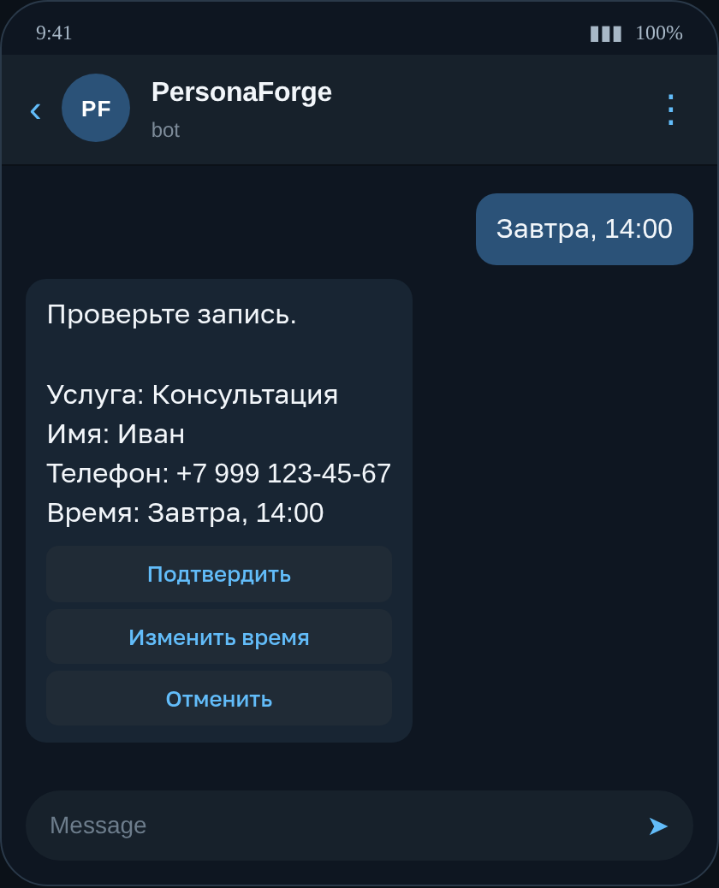

# PersonaForge

**Движок ботов, где сценарий — это данные, а не код.**

[](#запуск)
[](#как-устроено)
[](#инварианты)
[](#тесты)
[](LICENSE)

**[Открыть case study →](https://jefo.github.io/persona-forge/)**

Рабочее приложение на движке — **[JTBD Lead Qualifier](https://github.com/jefo/jtbd-lead-qualifier)**: квалификация лидов, мультивыбор, условный пре-оффер и карточка лида.



---

## Что это

Бот описывается объектом из трёх частей:

- **FSM** — состояния и переходы по событиям;
- **ViewMap** — экран для каждого состояния;
- **Form** — поля, которые бот собирает по ходу диалога.

Движок проверяет, что все три части согласованы, создаёт диалог и двигает его по событиям. Добавить услугу, вопрос или блюдо — значит добавить данные, а не ветку `if`.

```ts
export const appointmentBot = {
  name: "Appointment Bot",
  fsm: {
    initialState: "welcome",
    states: [
      { id: "welcome", on: [{ event: "BOOK", target: "service" }] },
      {
        id: "service",
        on: [{ event: "PICK", target: "confirm", assign: { service: "Консультация" } }]
      },
      { id: "confirm", on: [{ event: "CONFIRM", target: "booked" }] },
      { id: "booked", on: [] }
    ]
  },
  viewMap: {
    nodes: [
      {
        id: "welcome",
        props: {
          text: "Запись на приём",
          buttons: [{ label: "Записаться", event: "BOOK" }]
        }
      },
      {
        id: "service",
        props: {
          text: "Выберите услугу:",
          buttons: [{ label: "Консультация", event: "PICK" }]
        }
      },
      {
        id: "confirm",
        props: {
          text: "Проверьте: {{service}}",
          buttons: [{ label: "Подтвердить", event: "CONFIRM" }]
        }
      },
      { id: "booked", props: { text: "Готово: {{service}}" } }
    ]
  },
  form: {
    fields: {
      service: { type: "string", required: true }
    }
  }
} satisfies BotPersonaDefinition;
```

---

## Что умеет

- Переходы по событиям с `assign` из payload, формы или литерала.
- Мультивыбор через `{ op: "add" }` и условные переходы (`cond`).
- Типизированная форма: `string`, `number`, `boolean`, `array`, `object`.
- Вложенные шаблоны вроде `{{estimate.price}}`.
- Кнопки с payload и inline-клавиатура Telegram.
- Сброс формы на переходе (`resetForm`).
- Автоматическое завершение диалога в состоянии без переходов.
- История переходов с временем.
- Рендер текста с подстановкой полей `{{field}}`.
- Telegram-payload с inline-клавиатурой.
- In-memory репозитории и подменяемые порты.
- CLI-демо записи на приём.
- **52 теста**, **123 expect**.

---

## Три бота-примера

| Бот | Что показывает |
| --- | --- |
| `appointmentBot` | 8 состояний, сбор четырёх полей, подтверждение, отмена |
| `faqBot` | ветвление, возврат в меню, пустая форма |
| `restaurantBot` | выбор блюда, число в форме, корзина |

Все три — обычные объекты в `src/examples/`. Ни одного класса под конкретный бот.

---

## Запуск

Нужен [Bun](https://bun.com).

```bash
bun install
bun test
bunx tsc --noEmit
bun run demo
```

`bun run demo` проигрывает запись на приём: старт → услуга → имя → телефон → время → подтверждение. В конце печатает состояние диалога и заполненную форму.

---

## Как устроено

```text
src/
├── domain/
│   ├── fsm.ts              состояния, переходы, инварианты
│   ├── view-map.ts         экран для каждого состояния
│   ├── form.ts             типизированные поля диалога
│   ├── bot-persona.ts      агрегат определения и кросс-проверки
│   └── conversation.ts     текущее состояние, форма, история
├── application/
│   ├── engine.ts           composition root
│   ├── use-cases.ts        define / start / handle
│   └── ports.ts            репозитории
├── rendering/
│   ├── render.ts           текст + кнопки
│   └── telegram.ts         Bot API payload
├── infrastructure/
│   └── memory-repositories.ts
├── examples/
│   ├── appointment-bot.ts
│   ├── faq-bot.ts
│   └── restaurant-bot.ts
└── demo/
    └── appointment.ts
```

Поток:

```text
definition
  → BotPersona (инварианты)
  → Conversation.start(chatId)
  → process(event, payload)
  → Form
  → ViewMap
  → renderMessage()
  → Telegram payload
```

`Conversation.process()` сначала собирает новую форму, и только потом меняет состояние. Если payload неполный или значение не того типа, диалог остаётся на месте — частично применённых переходов нет.

---

## Инварианты

`BotPersona` не даст сохранить определение, если:

- `initialState` не существует;
- переход ведёт в несуществующее состояние;
- у состояния нет экрана или у экрана нет состояния;
- `assign` пишет в поле, которого нет в форме;
- литерал не совпадает с типом поля;
- `{{поле}}` в тексте не существует в форме;
- кнопка отправляет событие, которого нет из этого состояния.

Это ловит большинство ошибок сценария до запуска бота.

---

## Тесты

```text
52 pass
0 fail
123 expect() calls
```

Покрыто:

- инварианты FSM и ViewMap;
- defaults, типы и required в форме;
- кросс-проверки `BotPersona`;
- переходы, payload, литералы, сброс формы;
- атомарность при ошибке;
- завершение и отмена диалога;
- рендер шаблонов и Telegram-клавиатуры;
- полный сценарий записи;
- FAQ и меню ресторана;
- повторный старт после завершения.

---

## Ограничения

- **Нет Telegram-рантайма.** Есть только преобразование в payload; polling/webhook не включён.
- **In-memory хранилище.** Диалоги и определения теряются при перезапуске.
- **Типы формы — runtime.** `type: "string"` проверяется в рантайме, а не компилятором.
- **Только текст и кнопки.** Нет фото, файлов, геолокации и других компонентов.
- **Условия простые.** `equals`, `not_equals`, `contains` — без выражений и вложенной логики.
- **Один активный диалог на чат.** Без блокировок и конкурентности.
- **Нет локализации.** Тексты лежат в определениях на одном языке.
- **Нет аналитики.** Воронка и конверсия не собираются.
- **Нет версионирования определений.** Старые диалоги не мигрируют на новую схему.

---

## Откуда взялось

Проект вырос из `bot-dev-lead-bot` — попытки сделать бота, который квалифицирует заявки на разработку ботов: роль → ниша → боль → кейс → лид.

Само приложение так и не было доделано: транспорт, презентеры и карточка лида остались прототипом. Переиспользуемой частью оказался движок — описание бота, переходы, форма и проверки. PersonaForge — это выделенная, переписанная и покрытая тестами версия этой части.

---

## Что дальше

- Вынести Telegram-адаптер из JTBD Lead Qualifier в отдельный пакет движка.
- Postgres/Redis для определений и диалогов.
- Компоненты: фото, документ, геолокация, несколько кнопок в ряд.
- Локализация через каталог текстов.
- Проверка обязательных полей перед финальным переходом.
- Версионирование персон и миграции активных диалогов.
- Метрики воронки: старт → шаг → финал.

---

## Лицензия

MIT.
